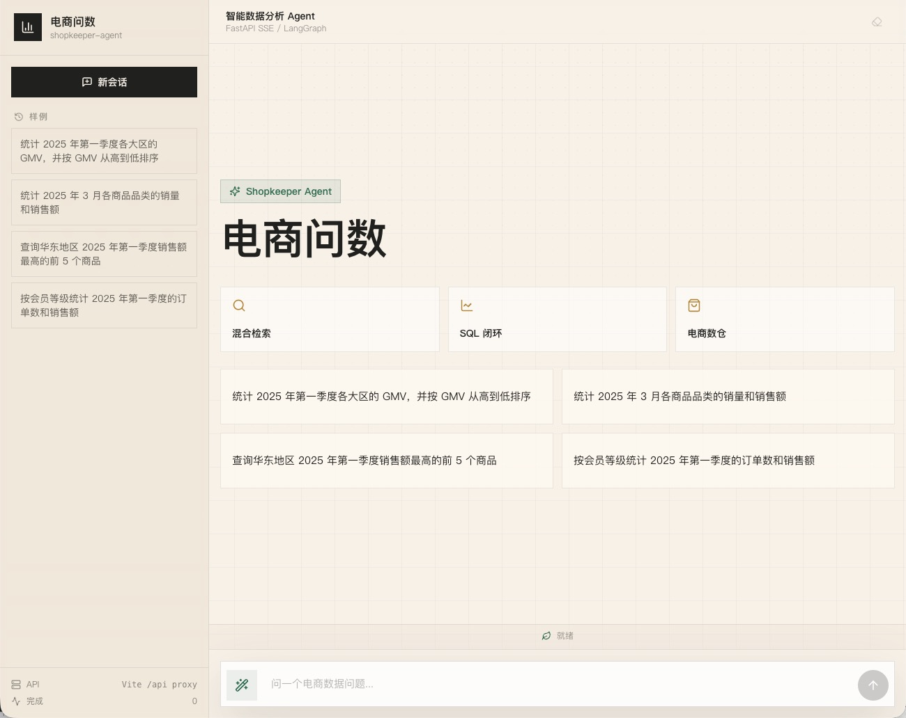
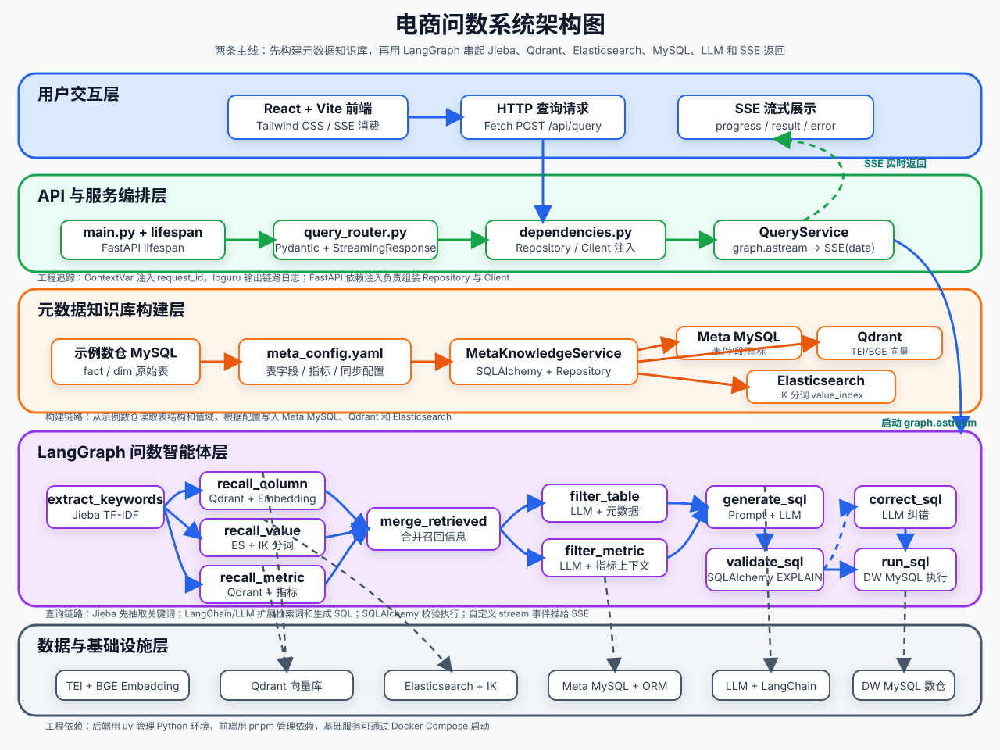

<div align="center">
  <h1>电商问数 · 智能数据分析 Agent</h1>
  <h4><b>shopkeeper-agent</b></h4>
  <p><em>自然语言提问，自动完成元数据召回、SQL 生成校验与执行，并通过 SSE 实时展示完整分析过程的智能问数系统</em></p>


</div>



## 项目简介

在真实数据分析场景中，业务同学不会写 SQL，分析师也很难随时记住所有表结构、字段含义和指标口径。如果把自然语言问题直接交给大模型写 SQL，很容易出现表选错、字段选错、指标理解错和 SQL 幻觉等问题。

本项目实现了一个面向电商数仓的智能问数系统：用户用自然语言提问，系统先从元数据知识库中召回相关表、字段、指标与字段取值，再由大模型基于结构化上下文生成 SQL，经校验、纠错后在数仓执行，最终以流式方式把过程和结果返回给前端。

核心链路：

```text
用户自然语言问题
  → 关键词抽取与扩展
  → 字段 / 指标 / 字段取值 三路并行召回
  → 召回信息按表合并、语义精筛、补全上下文
  → 大模型生成 SQL
  → EXPLAIN 校验，失败则带报错信息纠错
  → 执行 SQL 并返回结果
  → SSE 实时推送每个节点的执行过程到前端
```

## 系统架构



系统分为两条主线：

- **构建期（离线）**：同步脚本读取配置，把数仓中的表、字段、指标元数据写入 MySQL 元数据库；把字段名、描述、别名等文本向量化后写入 Qdrant；把文本型维度字段的真实取值写入 Elasticsearch。
- **查询期（在线）**：LangGraph 编排的问数智能体基于元数据知识库完成检索、上下文构建、SQL 生成校验与执行，FastAPI 通过 SSE 把过程流式交付给前端。

元数据知识库由三部分组成：

| 组件 | 存储内容 | 作用 |
| --- | --- | --- |
| MySQL 元数据库（`meta`） | `table_info`、`column_info`、`metric_info`、`column_metric` | 完整、权威的结构化元数据 |
| Qdrant | 字段与指标的语义向量（名称 / 描述 / 别名分别建点） | 语义召回字段与指标 |
| Elasticsearch | 字段真实取值（如「华北」「黄金会员」） | 自然语言值到库内真实值的映射 |

## 技术栈

| 层 | 技术 | 说明 |
| --- | --- | --- |
| 后端框架 | FastAPI | HTTP 接口、依赖注入、生命周期管理、SSE 流式返回 |
| 智能体编排 | LangGraph | 关键词抽取、并行召回、合并过滤、SQL 生成校验执行等节点 |
| 大模型 | LangChain + OpenAI 兼容接口 | 默认接入硅基流动，可在配置中切换任意兼容平台 |
| 向量数据库 | Qdrant | 字段 / 指标语义向量检索 |
| 全文检索 | Elasticsearch（IK 分词） | 字段取值全文检索 |
| 向量化服务 | TEI + `BAAI/bge-large-zh-v1.5` | 中文文本向量化（1024 维） |
| 数据库 | MySQL 8.0 | 示例数仓 `dw` + 元数据库 `meta` |
| ORM | SQLAlchemy | 元数据库与数仓数据访问 |
| 中文分词 | jieba（TF-IDF） | 问题关键词抽取 |
| 配置 | OmegaConf + YAML | 分层配置与环境变量替换 |
| 前端 | React 19 + Vite + Tailwind CSS + TypeScript | 聊天式问数界面与 SSE 流程展示 |
| 环境管理 | uv / Docker Compose | 依赖与基础服务编排 |

## 项目结构

```text
shopkeeper-agent/
├── app/
│   ├── agent/            # 问数智能体与 LangGraph 图
│   │   └── nodes/        # 关键词抽取、召回、合并、过滤、SQL 生成/校验/执行等节点
│   ├── api/              # FastAPI 路由、依赖注入、请求模型、生命周期
│   │   ├── routers/
│   │   └── schemas/
│   ├── clients/          # MySQL / Qdrant / ES / Embedding 客户端与管理器
│   ├── conf/             # 配置加载（YAML → dataclass）
│   ├── core/             # 日志、请求上下文等基础能力
│   ├── entities/         # 业务实体
│   ├── models/           # SQLAlchemy ORM 模型
│   ├── prompt/           # 提示词加载工具
│   ├── repositories/     # 数据访问层
│   │   ├── es/           # Elasticsearch 读写
│   │   ├── mysql/        # MySQL 读写
│   │   └── qdrant/       # Qdrant 读写
│   ├── scripts/          # 元数据知识库构建脚本
│   └── services/         # 业务逻辑层（召回服务、问数服务等）
├── conf/                 # 项目配置（数据库、向量库、ES、LLM、日志）
├── docker/               # docker-compose 与 MySQL/ES/Embedding 初始化资源
│   ├── elasticsearch/    # 含 IK 中文分词插件
│   ├── embedding/        # bge-large-zh 模型挂载目录
│   └── mysql/            # meta.sql / dw.sql 初始化脚本
├── frontend/             # React + Vite 前端
├── prompts/              # 静态提示词文件
├── main.py               # FastAPI 入口
└── pyproject.toml
```

## 快速开始

### 1. 环境准备

- Python ≥ 3.14
- [uv](https://docs.astral.sh/uv/)
- Docker 与 Docker Compose
- Node.js 与 pnpm
- 一个兼容 OpenAI 接口的大模型 API Key

### 2. 安装后端依赖

```bash
uv sync
```

### 3. 配置大模型 API Key

```bash
cp .env.example .env
```

在 `.env` 中填入真实密钥：

```bash
LLM_API_KEY=your_real_api_key
```

默认使用硅基流动的 OpenAI 兼容接口，如需更换模型平台，修改 `conf/app_config.yaml` 中的 `model_name` 和 `base_url`。

### 4. 准备 Embedding 模型

项目通过 [Text Embeddings Inference](https://github.com/huggingface/text-embeddings-inference) 加载 `BAAI/bge-large-zh-v1.5`，模型文件较大不入库，请下载到 Docker 挂载目录：

```bash
uv run hf download BAAI/bge-large-zh-v1.5 --local-dir docker/embedding/bge-large-zh-v1.5
```

### 5. 启动基础服务

```bash
docker compose -f docker/docker-compose.yaml up -d
```

`docker/mysql/dw.sql` 和 `docker/mysql/meta.sql` 会在 MySQL 容器首次启动时自动初始化数仓与元数据库。

默认数据库账号为 `shopkeeper`，密码为 `shopkeeper_dev`，仅用于本地开发。已有 MySQL 数据卷不会重新执行初始化脚本；升级已有部署时，请在 `conf/app_config.yaml` 中保留现有连接账号和密码，或先创建新账号并授予 `dw`、`meta` 数据库权限。

| 服务 | 端口 |
| --- | --- |
| MySQL | `3306` |
| Elasticsearch | `9200` |
| Kibana | `5601` |
| Qdrant | `6333`（HTTP）/ `6334`（gRPC） |
| Embedding（TEI） | `8081` |

### 6. 构建元数据知识库

```bash
uv run python -m app.scripts.build_meta_knowledge -c conf/meta_config.yaml
```

该脚本会把表与字段元数据写入 MySQL，字段 / 指标向量写入 Qdrant，字段真实取值写入 Elasticsearch。

### 7. 启动后端

```bash
uv run fastapi dev main.py
```

- 接口地址：`http://127.0.0.1:8000`
- 交互式文档：`http://127.0.0.1:8000/docs`

### 8. 启动前端

```bash
cd frontend
pnpm install
pnpm dev
```

打开 `http://127.0.0.1:5173`，Vite 会把 `/api` 请求代理到后端 `8000` 端口。

## 接口说明

### `POST /api/query`

请求体：

```json
{
  "query": "统计华北地区的销售总额"
}
```

响应为 `text/event-stream`（SSE），消息类型：

| 类型 | 含义 |
| --- | --- |
| `progress` | LangGraph 节点执行进度 |
| `result` | 最终 SQL 与查询结果 |
| `error` | 异常信息 |

## 示例数据说明

数仓 `dw` 采用星型模型，包含一张事实表和四张维度表：

- `fact_order`：订单事实表（订单金额、购买数量等度量）
- `dim_customer`：客户维度（含会员等级）
- `dim_product`：商品维度（品牌、品类）
- `dim_region`：地区维度（大区、省份）
- `dim_date`：日期维度（年、季、月、日）

可以尝试的问题示例：

- 统计华北地区的销售总额
- 各会员等级的订单数量分别是多少
- 苹果品牌在华东和华南的销售额对比
- 统计 2025 年第一季度各品类 GMV 排名

## 工作流节点

| 阶段 | 节点职责 |
| --- | --- |
| 关键词抽取 | jieba TF-IDF 抽取检索词，保留原始问题做语义兜底 |
| 并行召回 | 字段（Qdrant）、指标（Qdrant）、字段取值（ES）三路粗召回 |
| 信息合并 | 召回结果按表归组，取值挂回字段，指标关联相关字段 |
| 语义过滤 | 结合问题对表、字段、指标精筛，补全主外键 |
| 补充上下文 | 当前时间、数据库类型与版本等环境信息 |
| 生成 SQL | 大模型基于完整上下文生成查询语句 |
| 校验 / 纠错 | `EXPLAIN` 预检查，失败时带报错信息重写 |
| 执行 SQL | 校验通过后在数仓执行并返回结果 |

## 可扩展方向

- 字段取值检索叠加向量检索，实现真正的混合检索
- 多轮问数记忆与上下文追问
- SQL 安全审计与只读权限控制
- 查询结果缓存与可视化图表
- 多数据源、多租户与权限隔离
- 生成 SQL 的评测集与回归测试

## License

[MIT](LICENSE)
